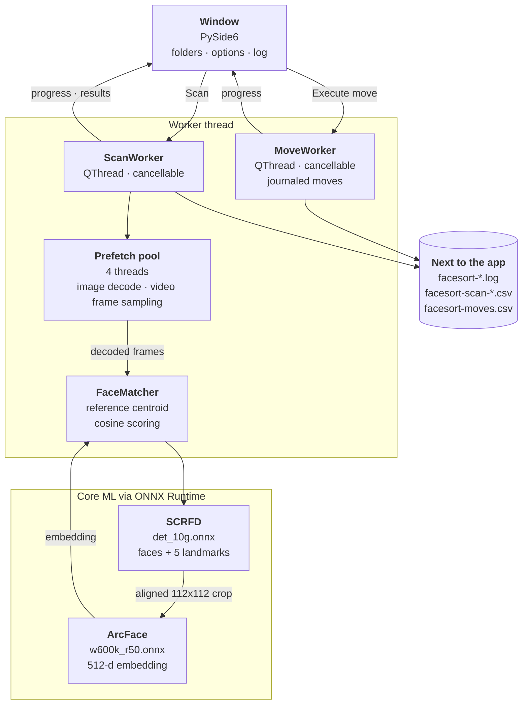
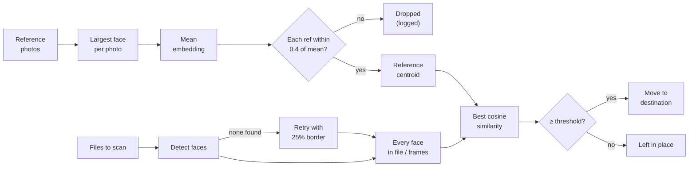

<h1 align="center">
  
  
  
  
  <br>
  <br>
  <code><strong>FaceSort</strong></code>
</h1>

<p align="center">
  
  
  
  
</p>

<p align="center">
  Find every photo and video of one person in a folder and move them out, by face.<br>
  Single-window macOS app running SCRFD detection and ArcFace recognition on the Apple Neural Engine through Core ML.
</p>

---

## Install

Open `FaceSort-<version>-arm64.dmg` and drag **FaceSort** onto **Applications**. FaceSort runs on Apple Silicon Macs with macOS 14 or later (onnxruntime publishes no Intel macOS builds). The first launch downloads the face model (about 190 MB).

<br>

## Quick Start

```sh
uv sync
uv run facesort    # downloads the face model on first launch, see Models
```

Pick a folder of reference photos, a folder to scan and a destination, then **Scan**. Review the match count and log, adjust the threshold if needed, then **Execute move**.

<br>

## Features

- **Seeded matching**: a handful of photos of one person is enough; no training step
- **Outlier-proof references**: a reference photo whose largest face is someone else is detected and dropped automatically
- **Photos and videos**: videos are judged on evenly sampled frames (10 by default, adjustable)
- **Optional subfolder scan**: off by default; hidden folders and the destination are always skipped
- **Live threshold**: changing the match threshold after a scan updates the match count without rescanning
- **Lookalike flagging**: matches below 0.45 are logged as `review`, with how many reference photos each one agrees with
- **Tight crops handled**: a face filling the whole frame, which the detector misses at normal scale, is found on a padded retry
- **Name conflicts**: when the destination already has the name, keep both (Finder-style `name 2.jpg`) or overwrite, set by **Name exists**; every move is journaled for undo
- **Progress and cancel**: scan and move both run in the background with a progress bar, a DONE or CANCELLED status line, and a Cancel that stops cleanly after the current file
- **Readable logs**: color-coded log view (matches, warnings, errors, completions), and a fresh log file for every scan
- **bitwise0x.com theme**: dark surfaces with the sodium amber accent, the same palette as the site
- **Apple Silicon native**: Core ML execution on the Neural Engine and GPU, with parallel file decoding feeding the model
- **Model on first launch**: the face model downloads from the repo's releases with a progress bar; any other InsightFace pack in the models folder appears in the Model dropdown
- **Updates**: **Check for updates** in the help dialog downloads the latest release's DMG and restarts the app; releases get their DMG from `release-app.sh`
- **Standalone app**: `build.sh` produces `FaceSort.app`
- **Built-in help**: the **?** button (top right) opens a guide to every setting, the buttons and how to read the results

<br>

## Architecture



<br>

## How It Works



1. **References**: the largest face in each reference photo is embedded with ArcFace. Their mean is the reference centroid; any reference below 0.4 similarity to it is a different person and is dropped.
2. **Detection**: SCRFD finds every face and its five landmarks. When it finds none, it retries once on the image with a 25% border, which brings a face that fills the frame into the size range it detects. Each face is aligned to the ArcFace template and embedded.
3. **Scoring**: a file's score is its best face's cosine similarity to the centroid. Videos take the best across their sampled frames.
4. **Moving**: files at or above the threshold move to the destination. Nothing moves until **Execute move**.

<br>

## Progress, Cancel and Logs

- The progress bar tracks both the scan and the move; the line below it shows the count while running, then **DONE** or **CANCELLED** with a summary.
- **Cancel** stops a scan or a move after the current file. A cancelled scan keeps the results it reached, and its matches can still be moved. A cancelled move leaves every file either fully moved and journaled or untouched.
- Closing the window during a run cancels it and waits up to 30 s for the current file before quitting.
- Each **Scan** clears the log view and starts a new log file; the move that follows writes to the same file. The view colors matches green, review matches and warnings orange, errors red and completions amber; the log files stay plain text.

<br>

## Options

| Option | Default | Description |
|---|---|---|
| Reference faces | | Folder of photos of the person to find |
| Folder to scan | | Folder searched for that person |
| Move matches to | | Destination; created if missing |
| Name exists | Keep both | A name already in the destination: keep both, the moved file numbered (`IMG_1 2.png`), or overwrite |
| Model | `buffalo_l` | Installed model pack |
| Scan subfolders | off | Also scan subfolders; matches land flat in the destination |
| Include videos | on | Score `.mov`, `.mp4`, `.m4v`, `.avi`, `.mkv` |
| Frames | `10` | Frames sampled per video; scan time per video grows with it |
| Match threshold | `0.35` | Minimum score to count as a match |

Settings persist between launches.

<br>

## Scores

Score is the cosine similarity between ArcFace embeddings, from -1 to 1. On a 3,800-file test library, the person searched for scored 0.35 and up while everyone else scored 0.30 and below, which sets the 0.35 default. Small, blurred, side-on or heavily filtered faces score lower; lower the threshold to catch them, and check the scan CSV around the cutoff.

Scores from 0.35 to 0.45 are where real but hard shots and lookalikes overlap. Those matches are logged as `review` (orange) rather than `match` (green), and the done line counts them. Each match also shows `refs N/M`: how many of the M reference photos its face reaches 0.35 with on its own. A true match usually agrees with most of them (13/13); a lookalike resembles the average face but few individual photos (0/13, 1/13). Raising the threshold drops review matches without a rescan.

<br>

## Output Files

Logs and scan reports go to `~/Library/Logs/FaceSort` (**Show logs folder** in the help dialog); the move journal goes to `~/Library/Application Support/FaceSort`:

| File | Contents |
|---|---|
| `facesort-<timestamp>.log` | Log of one scan and the move that follows it; each scan starts a new one |
| `facesort-scan-<timestamp>.csv` | Every scanned file with its score, face count and reference agreement (`ref_agree`, `N/M`) |
| `facesort-moves.csv` | `source,destination,action` per moved file, for undo; action is `moved`, `renamed` (kept both) or `overwrote` (the replaced file is gone) |

<br>

## Models

Model packs live in `~/Library/Application Support/FaceSort/models/<pack>/`; when run from source, the repo's `models/<pack>/` is read too. Neither is committed: the files are large, and the InsightFace pretrained weights are licensed for non-commercial research use only.

On first launch, with no pack installed, the app downloads `buffalo_l.zip` from the repo's `models-buffalo_l` release and unpacks it there, showing "Downloading face detection model, please wait..." with a progress bar. Scanning waits until it finishes. The release is pinned: the app always takes that tag, and the zip on it is replaced by hand to change the model.

Model and update downloads resume: a partial file stays in `~/Library/Application Support/FaceSort/downloads/` when the app quits or the download is cancelled, and the next attempt continues from it. A finished download is checked against GitHub's SHA-256 digest of the asset. The repository is private, so downloads authenticate with the GitHub CLI's login on this Mac.

A pack needs a detector (`det_*` or `scrfd*`) and a recognizer (`w600k*` or `glintr*`); other files are ignored.

| Pack | Files | Size | Recognizer |
|---|---|---|---|
| `buffalo_l` | `det_10g.onnx`, `w600k_r50.onnx` | 183 MB | ArcFace R50, WebFace600K |

The two files come from the InsightFace [`buffalo_l.zip`](https://github.com/deepinsight/insightface/releases/download/v0.7/buffalo_l.zip) release.

<br>

## Performance

ONNX Runtime's Core ML provider runs both models on the Neural Engine and GPU. Measured on an M1 over 40 photos:

| Execution | Inference time |
|---|---|
| Core ML, NeuralNetwork format | 1.73 s |
| Core ML, MLProgram format | 3.52 s |
| CPU | 6.35 s |

Decoding the same photos took 3.05 s, more than inference, so files decode on a 4-thread prefetch pool ahead of the model.

<br>

## Requirements

- macOS 14 or later on Apple Silicon
- Python 3.12 and [uv](https://docs.astral.sh/uv/)
- The GitHub CLI (`gh`), logged in with access to this repository, for the first-launch model download and updates

<br>

## Development

```sh
uv sync
uv run facesort    # run from source
uv run pytest      # tests
./build.sh         # dist/FaceSort.app and dist/FaceSort-<version>-arm64.dmg
./release-app.sh   # after a release: build at the release tag and attach the DMG to that GitHub release
uv run python scripts/make_icon.py   # redraw assets/FaceSort.icns and FaceSort.png
```

Detection (SCRFD) and recognition (ArcFace) run directly on the ONNX models, with no dependency on the `insightface` Python package.

<br>

## Versioning

Every push to `main` runs `.github/workflows/release.yml`, which uses [python-semantic-release](https://python-semantic-release.readthedocs.io/) to read the [Conventional Commits](https://www.conventionalcommits.org/) since the last tag:

| Commit type | Release |
|---|---|
| `fix:`, `perf:` | patch |
| `feat:` | minor |
| `BREAKING CHANGE:` footer | minor while on 0.x, major after |
| anything else (`docs:`, `chore:`, `test:`, ...) | none |

A release sets the version in `pyproject.toml` and `facesort/__init__.py`, relocks `uv.lock`, updates `CHANGELOG.md`, commits them as `chore(release): X.Y.Z`, tags `vX.Y.Z` and creates the GitHub release. Pull before the next local commit. The app shows its version in **FaceSort > About FaceSort**, in each scan log, and in the `.app` bundle's Info.plist (set by `build.sh`).

<br>

## Troubleshooting

- **Model download fails on first launch**: check `gh auth status`, then reopen FaceSort. See [Models](#models).
- **A reference photo was dropped**: its largest face is someone else. Crop it to the right person or remove it.
- **"Reference has no face"**: no face was found even on the padded retry, usually a profile, a heavily obscured face, or a very small one. Replace it with a clearer photo.
- **Expected matches missing**: open the scan CSV, sort by score, and lower the threshold to just below the missed files.
- **Unreadable files**: logged and skipped; the scan continues.
- **"Still finishing the current file"** on close: a long video is mid-read; close again a moment later.

<br>

## Disclaimer

This project is not affiliated with or endorsed by InsightFace or Apple Inc. All product and company names are trademarks of their respective owners.
