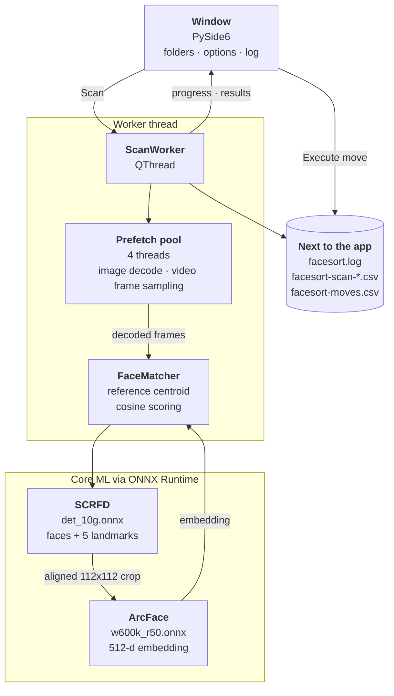
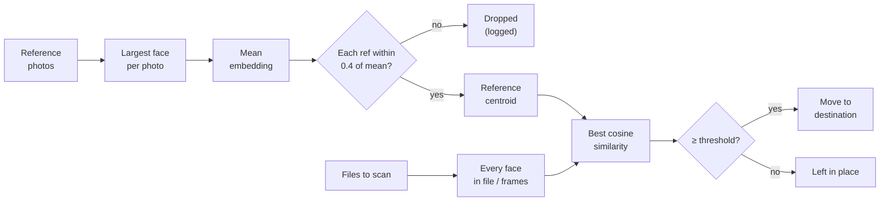

<h1 align="center">
  
  
  
  
  <br>
  <br>
  <code><strong>FaceSort</strong></code>
</h1>

<p align="center">
  
  
  
  
</p>

<p align="center">
  Find every photo and video of one person in a folder and move them out, by face.<br>
  Single-window macOS app running SCRFD detection and ArcFace recognition on the Apple Neural Engine through Core ML.
</p>

---

## Quick Start

```sh
uv sync
mkdir -p models/buffalo_l   # then add det_10g.onnx and w600k_r50.onnx, see Models
uv run facesort
```

Pick a folder of reference photos, a folder to scan and a destination, then **Scan**. Review the match count and log, adjust the threshold if needed, then **Execute move**.

<br>

## Features

- **Seeded matching**: a handful of photos of one person is enough; no training step
- **Outlier-proof references**: a reference photo whose largest face is someone else is detected and dropped automatically
- **Photos and videos**: videos are judged on evenly sampled frames (10 by default, adjustable)
- **Optional subfolder scan**: off by default; hidden folders and the destination are always skipped
- **Live threshold**: changing the match threshold after a scan updates the match count without rescanning
- **Safe moves**: never overwrites; name collisions are skipped and logged, every move is journaled for undo
- **Apple Silicon native**: Core ML execution on the Neural Engine and GPU, with parallel file decoding feeding the model
- **Model packs**: any InsightFace pack dropped into `models/` appears in the Model dropdown
- **Standalone app**: `build.sh` produces `FaceSort.app` with the models bundled inside

<br>

## Architecture



<br>

## How It Works



1. **References**: the largest face in each reference photo is embedded with ArcFace. Their mean is the reference centroid; any reference below 0.4 similarity to it is a different person and is dropped.
2. **Detection**: SCRFD finds every face and its five landmarks. Each face is aligned to the ArcFace template and embedded.
3. **Scoring**: a file's score is its best face's cosine similarity to the centroid. Videos take the best across their sampled frames.
4. **Moving**: files at or above the threshold move to the destination. Nothing moves until **Execute move**.

<br>

## Options

| Option | Default | Description |
|---|---|---|
| Reference faces | | Folder of photos of the person to find |
| Folder to scan | | Folder searched for that person |
| Move matches to | | Destination; created if missing, never overwritten |
| Model | `buffalo_l` | Model pack from `models/` |
| Scan subfolders | off | Also scan subfolders; matches land flat in the destination |
| Include videos | on | Score `.mov`, `.mp4`, `.m4v`, `.avi`, `.mkv` |
| Frames | `10` | Frames sampled per video; scan time per video grows with it |
| Match threshold | `0.35` | Minimum score to count as a match |

Settings persist between launches.

<br>

## Scores

Score is the cosine similarity between ArcFace embeddings, from -1 to 1. On a 3,800-file test library, the person searched for scored 0.35 and up while everyone else scored 0.30 and below, which sets the 0.35 default. Small, blurred, side-on or heavily filtered faces score lower; lower the threshold to catch them, and check the scan CSV around the cutoff.

<br>

## Output Files

Written next to `FaceSort.app` (the repo root when run from source):

| File | Contents |
|---|---|
| `facesort.log` | Full run log |
| `facesort-scan-<timestamp>.csv` | Every scanned file with its score and face count |
| `facesort-moves.csv` | `source,destination` per moved file, for undo |

<br>

## Models

`models/<pack>/` holds InsightFace ONNX packs. It is not committed: the files are large, and the InsightFace pretrained weights are licensed for non-commercial research use only. The app reads models only from this folder (and the copy bundled into the `.app`).

A pack needs a detector (`det_*` or `scrfd*`) and a recognizer (`w600k*` or `glintr*`); other files are ignored.

| Pack | Files | Size | Recognizer |
|---|---|---|---|
| `buffalo_l` | `det_10g.onnx`, `w600k_r50.onnx` | 183 MB | ArcFace R50, WebFace600K |

To set up `buffalo_l`, extract those two files from the InsightFace [`buffalo_l.zip`](https://github.com/deepinsight/insightface/releases/download/v0.7/buffalo_l.zip) release into `models/buffalo_l/`.

<br>

## Performance

ONNX Runtime's Core ML provider runs both models on the Neural Engine and GPU. Measured on an M1 over 40 photos:

| Execution | Inference time |
|---|---|
| Core ML, NeuralNetwork format | 1.73 s |
| Core ML, MLProgram format | 3.52 s |
| CPU | 6.35 s |

Decoding the same photos took 3.05 s, more than inference, so files decode on a 4-thread prefetch pool ahead of the model.

<br>

## Requirements

- macOS on Apple Silicon
- Python 3.12 and [uv](https://docs.astral.sh/uv/)
- An InsightFace model pack in `models/`

<br>

## Development

```sh
uv sync
uv run facesort    # run from source
uv run pytest      # tests
./build.sh         # dist/FaceSort.app with models/ bundled
```

Detection (SCRFD) and recognition (ArcFace) run directly on the ONNX models, with no dependency on the `insightface` Python package.

<br>

## Troubleshooting

- **"No model pack found"**: `models/` is empty or a pack is missing its detector or recognizer. See [Models](#models).
- **A reference photo was dropped**: its largest face is someone else. Crop it to the right person or remove it.
- **Expected matches missing**: open the scan CSV, sort by score, and lower the threshold to just below the missed files.
- **Unreadable files**: logged and skipped; the scan continues.

<br>

## Disclaimer

This project is not affiliated with or endorsed by InsightFace or Apple Inc. All product and company names are trademarks of their respective owners.
