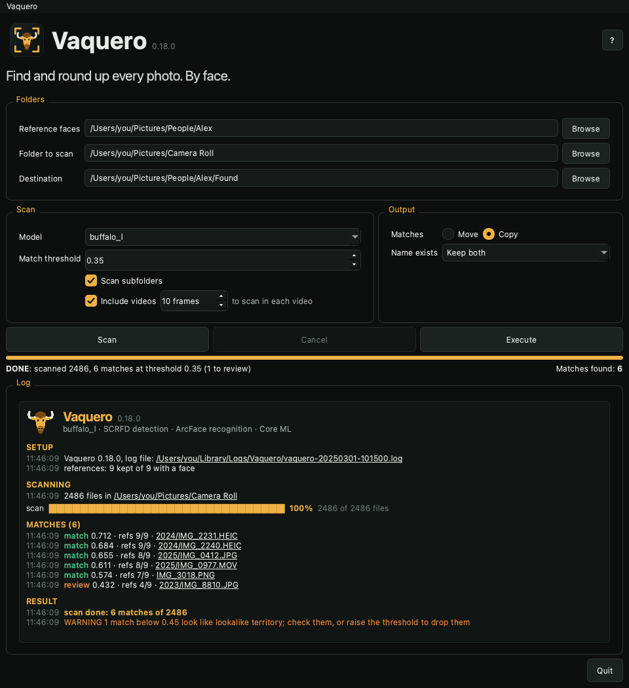
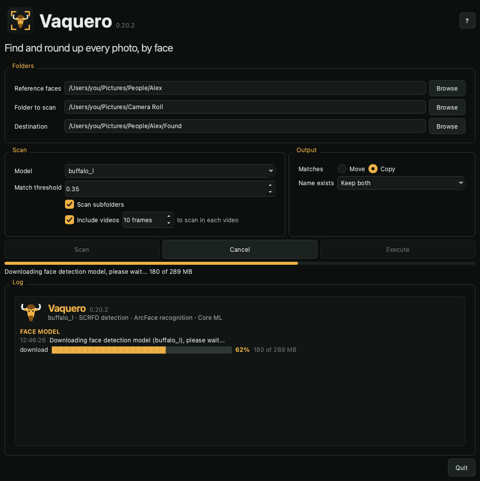
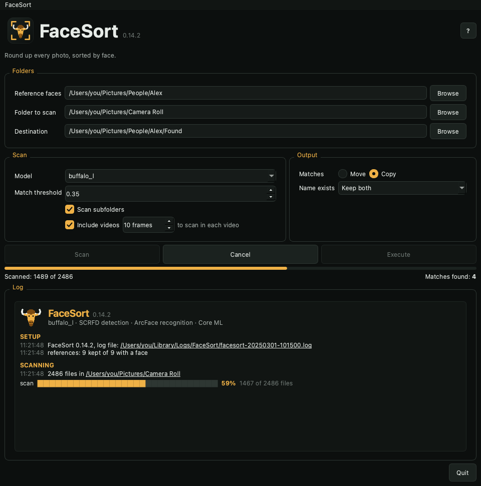
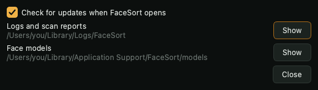
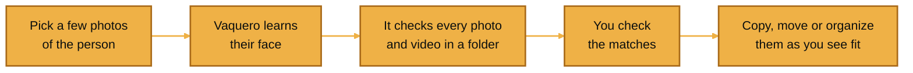
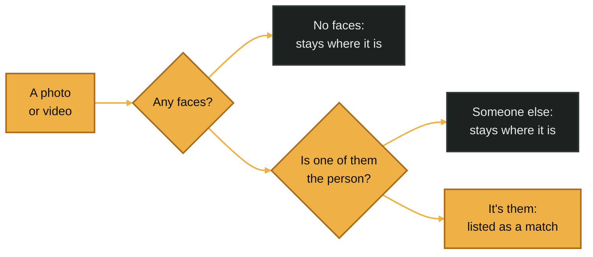

<h1 align="center">
  
  <br>
  <picture>
    <source media="(prefers-color-scheme: dark)" srcset="assets/wordmark-light.png">
    
  </picture>
</h1>

<h3 align="center">Find and round up every photo, by face</h3>

<p align="center">
  Point Vaquero at a few photos of someone.<br>
  It finds every photo and video of them, then copies, moves or organizes them as you see fit.<br>
  Runs on an open-source AI model, right on your Mac, fully private.
</p>

<p align="center">
  
  
  
  
  <br>
  
  
  
  
  
</p>

<br>

<p align="center">
  <a href="https://github.com/BitWise-0x/Vaquero/releases/latest"></a>
  <br>
  <sub>macOS 14 or later · <a href="#install">install steps</a></sub>
</p>

<br>

<p align="center">
  
</p>

---

## What It's For

- **A folder per person**: every photo of a family member, a friend or yourself, out of years of backups
- **One person from a shared dump**: an event, a trip or a group chat export
- **Reference sets**: every usable photo of a subject, for an album, a slideshow or a face-swap folder
- **Clean-up**: move someone's photos out of a mixed folder, or copy them and leave the originals

Three to five clear photos of the person are enough. No training.

<br>

## Screenshots

| First launch | Scanning |
|---|---|
|  |  |

| Help | Settings |
|---|---|
|  |  |

---

## Privacy

Vaquero runs on an open-source AI model, right on your machine. No photo, face or log leaves it.

<br>

## Install

1. Download `Vaquero-<version>-arm64.dmg` from [Releases](https://github.com/BitWise-0x/Vaquero/releases/latest).
2. Open it and drag **Vaquero** onto **Applications**.
3. Open Vaquero. The first time, macOS blocks it because the app is not signed with an Apple developer certificate:
   - **macOS 15 and later**: click **Done**, open **System Settings > Privacy & Security**, scroll to *"Vaquero" was blocked*, click **Open Anyway**, then confirm.
   - **macOS 14**: Control-click (or right-click) Vaquero in Applications, choose **Open**, then **Open** again.

   This is needed once. Updates from inside the app open without it.
4. macOS asks once for each kind of place Vaquero opens: external drives, network shares, and the Desktop, Documents and Downloads folders. Click **Allow**. If you clicked Don't Allow, Vaquero shows a window with an **Open Settings** button and the steps to turn it back on.

Requires an Apple Silicon Mac with macOS 14 or later. The first launch downloads the face model (about 290 MB).

Pick the reference photos, a folder to scan and a destination, then **Scan**. Check the matches, choose **Copy** or **Move**, then **Execute**.

<br>

## Permissions

| Vaquero | Needs |
|---|---|
| Downloads the face model, checks for updates | Nothing |
| Keeps its settings, logs and model | Nothing |
| Reads photos on an external drive or network share, or in Desktop, Documents or Downloads | A one-time **Allow** for that place |
| Copies or moves the matches | The same **Allow** for the destination |
| Reads photos anywhere else in your home folder, such as Pictures | Nothing |

Vaquero checks the folders you picked when it opens and before each scan, so macOS asks right away rather than halfway through.

<br>

## Features

- **Fully private**: everything runs on your own Mac
- **A few photos are enough**: no training step
- **Bad references dropped**: a reference photo of the wrong person is spotted and left out
- **Photos and videos**: videos are checked on evenly spaced frames (10 by default)
- **Subfolders**: optional; hidden folders and the destination are skipped
- **Live threshold**: change it after a scan and the matches update without rescanning
- **Lookalikes flagged**: borderline matches are marked `review`
- **Copy or move**: with keep-both or overwrite when a name is taken; every copy and move can be undone from its journal
- **Progress and cancel**: for the scan, the copy or move, and the model download
- **Clickable log**: every file name opens the photo or video
- **Apple Silicon native**: Core ML on the Neural Engine and GPU
- **Updates**: **Vaquero > Check for Updates…**, or automatically at launch
- **Built-in help**: the **?** button explains every setting

<br>

## How It Works



For each photo or video:



<br>

## Under the Hood

1. **References**: the largest face in each reference photo is embedded with ArcFace. Their mean is the reference face; any reference below 0.4 similarity to it is a different person and is dropped.
2. **Detection**: SCRFD finds every face and its five landmarks. When it finds none, it retries once on the image with a 25% border, which brings a face that fills the frame into the size range it detects. Each face is aligned and embedded.
3. **Scoring**: a file's score is its best face's cosine similarity to the reference face. Videos take the best across their sampled frames.
4. **Copying or moving**: files at or above the threshold copy or move to the destination when you click **Execute**.

Both models run through ONNX Runtime on the Neural Engine and GPU. A pool of 4 threads decodes files ahead of the model, and scans, moves and copies run off the window's thread so it stays responsive.

<br>

## Progress, Cancel and Logs

- The progress bar tracks the model download, the scan and the move or copy; the line below it shows the count while running, then **DONE** or **CANCELLED** with a summary. The log draws the same progress as a bar of its own, updated in place.
- **Cancel** stops a scan, move or copy after the current file. A cancelled scan keeps the results it reached, and its matches can still be moved or copied. A cancelled move or copy leaves every file either fully done and journaled or untouched.
- Closing the window during a run cancels it and waits up to 30 s for the current file before quitting.
- The log opens with a small buffalo, the namesake of the `buffalo_l` model pack, with the version and engine. Each **Scan** clears the log view and starts a new log file; the move or copy that follows writes to the same file. The log is split into amber-headed sections (Setup, Scanning, Matches, Result, Move or Copy). The view colors matches green, review matches and warnings orange, errors red and completions amber, and every file name is a link that opens the photo or video; the log files stay plain text with `== Section ==` lines.

<br>

## Options

| Option | Default | Description |
|---|---|---|
| Reference faces | | Folder of photos of the person to find |
| Folder to scan | | Folder searched for that person |
| Destination | | Where matches go; created if missing |
| Move / Copy | Move | What **Execute** does with the matches |
| Name exists | Keep both | A name already in the destination: keep both, the new file numbered (`IMG_1 2.png`), or overwrite |
| Model | `buffalo_l` | Installed model pack |
| Scan subfolders | off | Also scan subfolders; matches land flat in the destination |
| Include videos | on | Score `.mov`, `.mp4`, `.m4v`, `.avi`, `.mkv` |
| Frames | `10` | Frames sampled per video; scan time per video grows with it |
| Match threshold | `0.35` | Minimum score to count as a match |

Settings persist between launches.

<br>

## Scores

Score is the cosine similarity between ArcFace embeddings, from -1 to 1. On a 3,800-file test library, the person searched for scored 0.35 and up while everyone else scored 0.30 and below, which sets the 0.35 default. Small, blurred, side-on or heavily filtered faces score lower; lower the threshold to catch them, and check the scan CSV around the cutoff.

Scores from 0.35 to 0.45 are where real but hard shots and lookalikes overlap. Those matches are logged as `review` (orange) rather than `match` (green), and the done line counts them. Each match also shows `refs N/M`: how many of the M reference photos its face reaches 0.35 with on its own. A true match usually agrees with most of them (13/13); a lookalike resembles the average face but few individual photos (0/13, 1/13). Raising the threshold drops review matches without a rescan.

<br>

## Output Files

Logs and scan reports go to `~/Library/Logs/Vaquero` (**Show logs folder** in the help dialog, or **Vaquero > Settings…**); the move journal goes to `~/Library/Application Support/Vaquero`:

| File | Contents |
|---|---|
| `vaquero-<timestamp>.log` | Log of one scan and the move or copy that follows it; each scan starts a new one |
| `vaquero-scan-<timestamp>.csv` | Every scanned file with its score, face count and reference agreement (`ref_agree`, `N/M`) |
| `vaquero-moves.csv` | `source,destination,action` per moved or copied file, for undo; action is `moved` or `copied`, plus `, renamed` (kept both) or `, overwrote` (the replaced file is gone) |

<br>

## Models

Vaquero uses `buffalo_l`, a face model pack from [InsightFace](https://github.com/deepinsight/insightface), the open-source face analysis project ([model zoo](https://github.com/deepinsight/insightface/tree/master/model_zoo)).

Model packs live in `~/Library/Application Support/Vaquero/models/<pack>/`; when run from source, the repo's `models/<pack>/` is read too. Neither is committed: the files are large, and the InsightFace pretrained weights are licensed for non-commercial research use only.

On first launch, with no pack installed, the app downloads `buffalo_l.zip` from InsightFace's own [v0.7 release](https://github.com/deepinsight/insightface/releases/tag/v0.7), checks it against a SHA-256 pinned in `vaquero/remote.py`, and unpacks `det_10g.onnx` and `w600k_r50.onnx` there. Scanning waits until it finishes.

Model and update downloads resume: a partial file stays in `~/Library/Application Support/Vaquero/downloads/` when the app quits or the download is cancelled, and the next attempt continues from it. A finished download is checked against its SHA-256. Downloads need no GitHub account.

A pack needs a detector (`det_*` or `scrfd*`) and a recognizer (`w600k*` or `glintr*`); other files are ignored.

| Pack | Files | Size | Recognizer |
|---|---|---|---|
| `buffalo_l` | `det_10g.onnx`, `w600k_r50.onnx` | 183 MB | ArcFace R50, WebFace600K |


<br>

## Performance

ONNX Runtime's Core ML provider runs both models on the Neural Engine and GPU. Measured on an M1 over 40 photos:

| Execution | Inference time |
|---|---|
| Core ML, NeuralNetwork format | 1.73 s |
| Core ML, MLProgram format | 3.52 s |
| CPU | 6.35 s |

Decoding the same photos took 3.05 s, more than inference, so files decode on a 4-thread prefetch pool ahead of the model.

<br>

## Requirements

- macOS 14 or later on Apple Silicon
- To run from source: Python 3.12 and [uv](https://docs.astral.sh/uv/)

<br>

## Development

```sh
uv sync
uv run vaquero    # run from source
uv run pytest      # tests
./build.sh         # dist/Vaquero.app and dist/Vaquero-<version>-arm64.dmg
uv run python scripts/make_icon.py   # redraw assets/Vaquero.icns, Vaquero.png and the log's buffalo.png
QT_QPA_PLATFORM=offscreen uv run python scripts/screenshots.py   # re-render docs/screenshots
```

Detection (SCRFD) and recognition (ArcFace) run directly on the ONNX models, with no dependency on the `insightface` Python package.

<br>

## Versioning

Every push to `main` runs `.github/workflows/release.yml`, which uses [python-semantic-release](https://python-semantic-release.readthedocs.io/) to read the [Conventional Commits](https://www.conventionalcommits.org/) since the last tag:

| Commit type | Release |
|---|---|
| `fix:`, `perf:` | patch |
| `feat:` | minor |
| `BREAKING CHANGE:` footer | minor while on 0.x, major after |
| anything else (`docs:`, `chore:`, `test:`, ...) | none |

A release sets the version in `pyproject.toml` and `vaquero/__init__.py`, relocks `uv.lock`, updates `CHANGELOG.md`, commits them as `chore(release): X.Y.Z`, tags `vX.Y.Z` and creates the GitHub release. A macOS runner then builds the DMG and attaches it to that release. Pull before the next local commit. The app shows its version in **Vaquero > About Vaquero**, in each scan log, and in the `.app` bundle's Info.plist (set by `build.sh`).

<br>

## Troubleshooting

- **Model download fails on first launch**: check the internet connection, then reopen Vaquero; the download resumes where it stopped. See [Models](#models).
- **A reference photo was dropped**: its largest face is someone else. Crop it to the right person or remove it.
- **"Reference has no face"**: no face was found even on the padded retry, usually a profile, a heavily obscured face, or a very small one. Replace it with a clearer photo.
- **Expected matches missing**: open the scan CSV, sort by score, and lower the threshold to just below the missed files.
- **Unreadable files**: logged and skipped; the scan continues.
- **"Still finishing the current file"** on close: a long video is mid-read; close again a moment later.

<br>

## License

[MIT](LICENSE). The libraries bundled in the app keep their own licenses, listed in [THIRD_PARTY_NOTICES.md](THIRD_PARTY_NOTICES.md). The face model is InsightFace's and licensed for non-commercial research use only.

<br>

## Disclaimer

This project is not affiliated with or endorsed by InsightFace or Apple Inc. All product and company names are trademarks of their respective owners.

<br>

---

<p align="center">
  <sub>A <a href="https://bitwise0x.com"><b>BitWise</b></a> product</sub>
</p>
