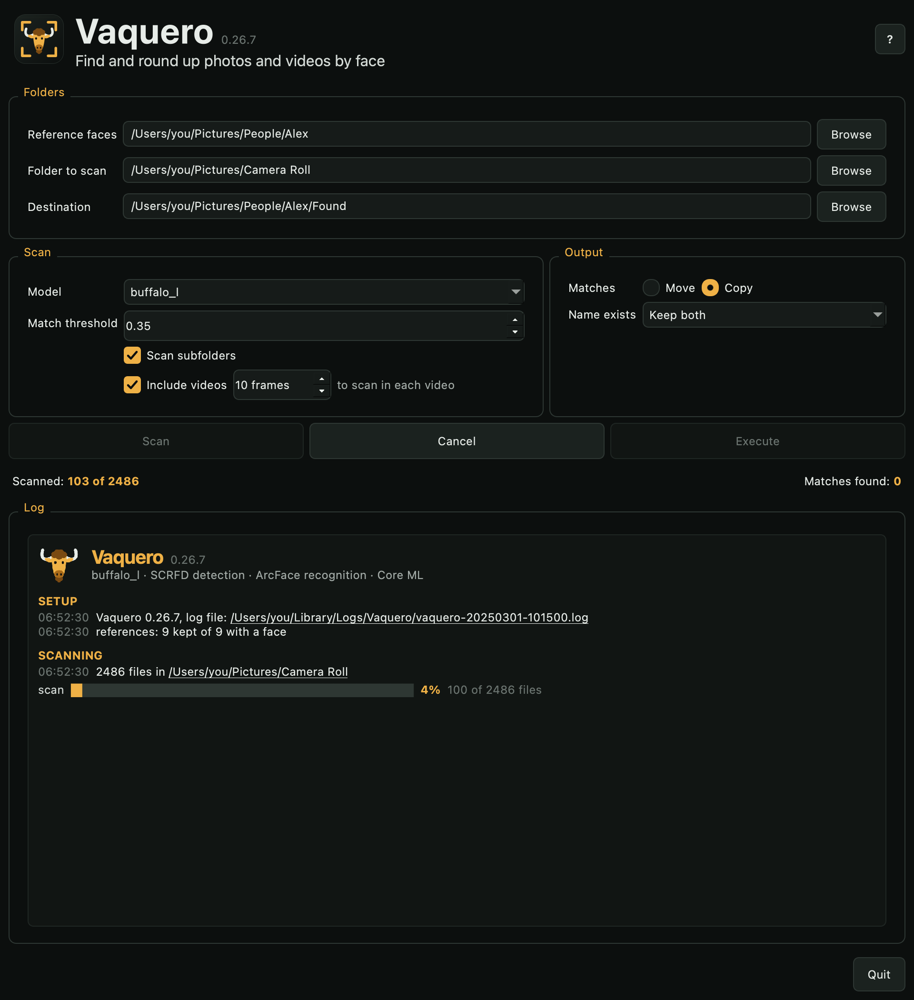
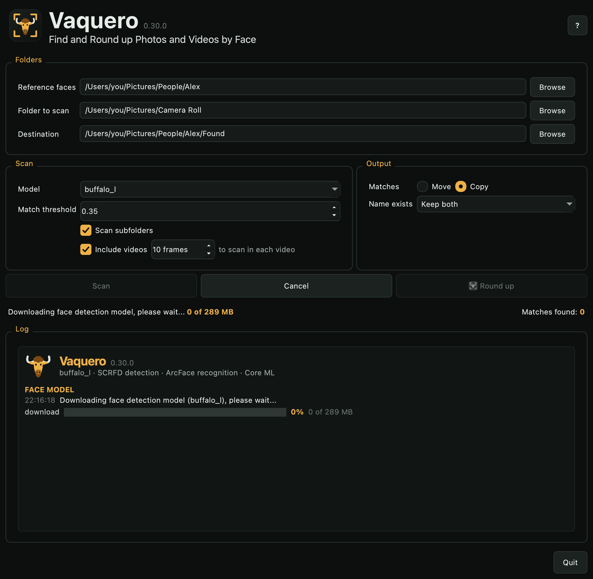
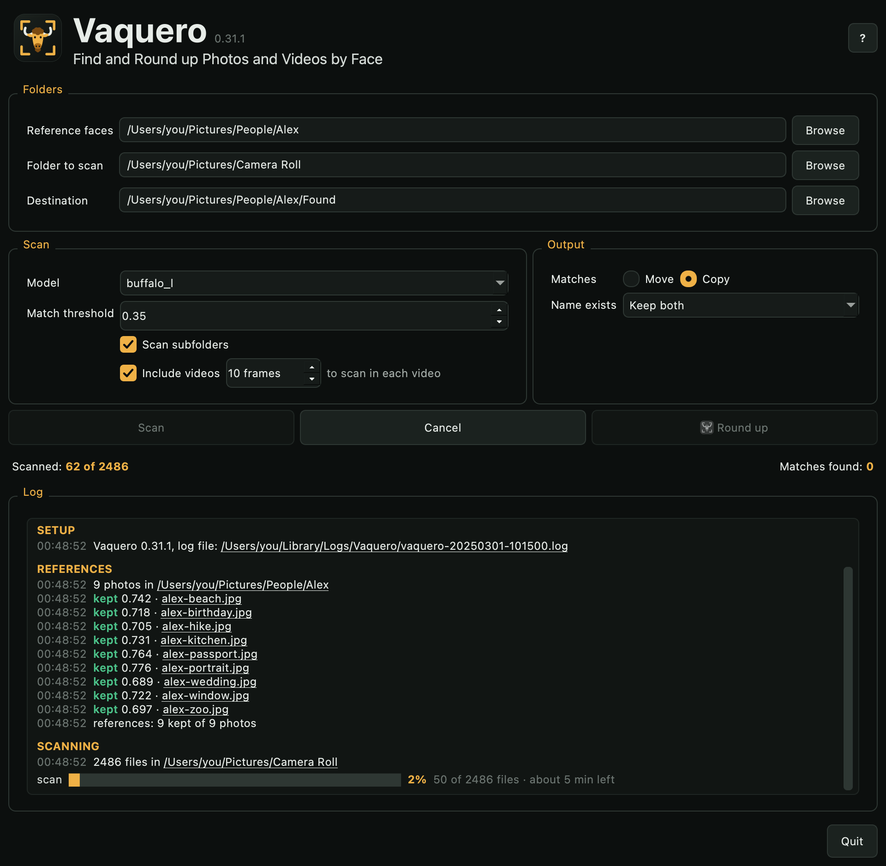
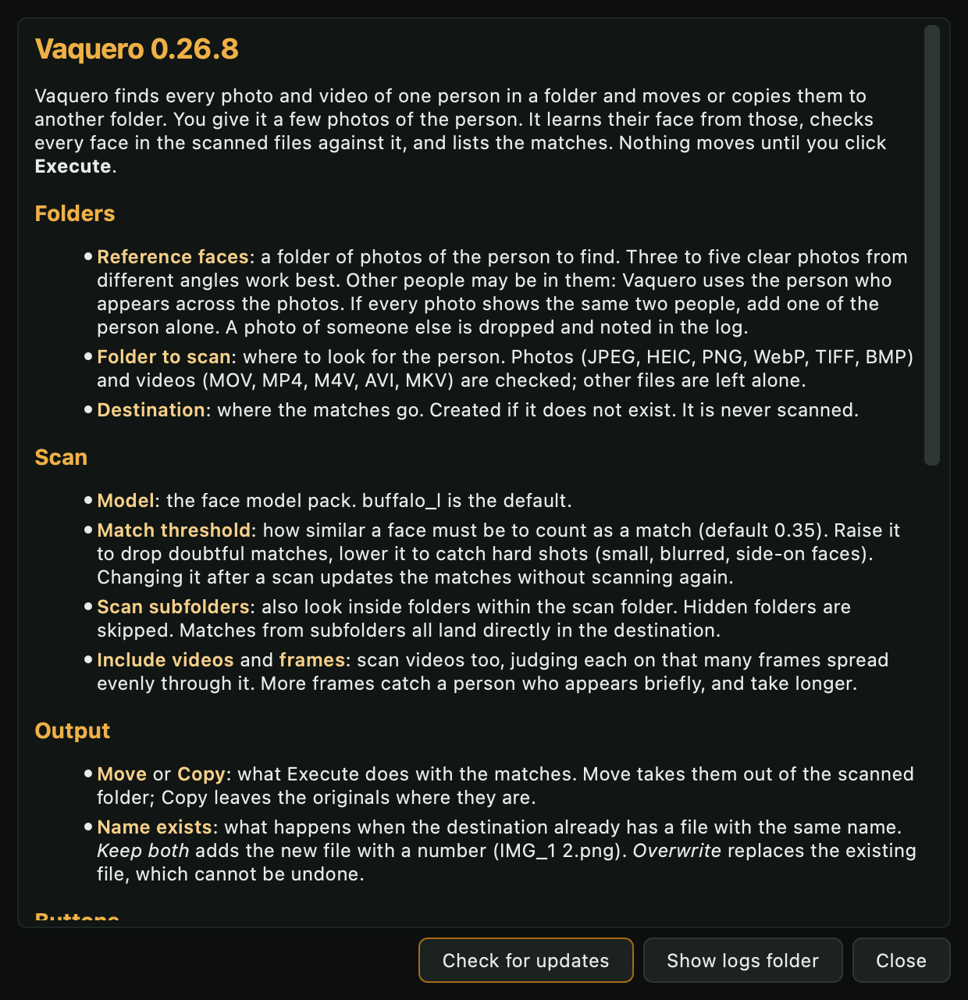
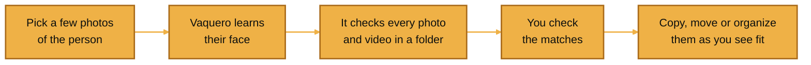
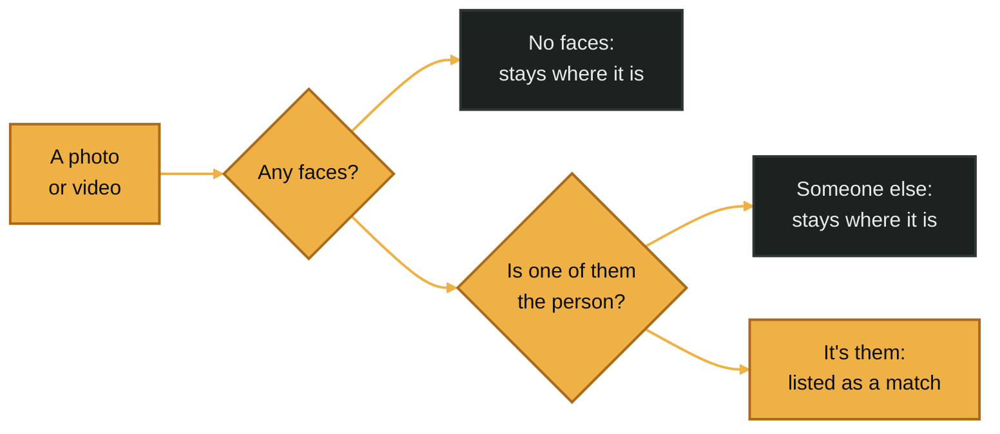

<p align="center">
  
</p>

<h1 align="center">
  
  
  
  
  <br>
  <br>
  <code><strong>Vaquero</strong></code>
</h1>

<p align="center">
  
  
  
  
</p>

<p align="center">
  <strong>Find and round up photos and videos by face.</strong><br>
  Point Vaquero at a few photos of someone. It can then scan and find every matching photo or video, and copy / move them wherever you want. It all runs locally. Nothing leaves your Mac.<br>
  Free, open source, no account, 100% private
</p>

<br>

<p align="center">
  <a href="https://github.com/BitWise-0x/Vaquero/releases/latest/download/Vaquero-arm64.dmg"></a>
  <br>
  <sub>macOS 14 or later · <a href="#install">install steps</a></sub>
  <br>
  <sub><a href="https://vaquero.bitwise0x.com">vaquero.bitwise0x.com</a></sub>
</p>

<br>

<p align="center">
  
</p>

---

## What It's For

- **A folder per person**: every photo and video of a family member, a friend or yourself, out of years of backups
- **One person from a shared dump**: an event, a trip or a group chat export
- **Albums and slideshows**: every photo and video of one person
- **Clean-up**: move someone's photos out of a mixed folder, or copy them and leave the originals

Three to five clear photos of the person are enough. No training.

<br>

## Screenshots

| First launch | Scanning |
|---|---|
|  |  |

| Help | Settings |
|---|---|
|  |  |

---

## Privacy

Vaquero runs on an open-source AI model, right on your machine. No photo, face or log leaves it.

<br>

## Install

1. Download [Vaquero-arm64.dmg](https://github.com/BitWise-0x/Vaquero/releases/latest/download/Vaquero-arm64.dmg).
2. Open it and drag **Vaquero** onto **Applications**.
3. Open Vaquero and click **Allow** when macOS asks about a folder.

Requires an Apple Silicon Mac with macOS 14 or later. The first launch downloads the face model (about 290 MB).

Pick the reference photos, a folder to scan and a destination, then **Scan**. Check the matches, choose **Copy** or **Move**, then **Execute**.

<br>

## Features

- **100% private**: everything runs on your own Mac
- **A few photos are enough**: no training step
- **Group photos as references**: Vaquero uses the person common to the photos; a photo of someone else is left out
- **Photos and videos**: JPEG, HEIC, PNG and more; videos are checked on evenly spaced frames (10 by default)
- **Subfolders**: optional; hidden folders and the destination are skipped
- **Live threshold**: change it after a scan and the matches update without rescanning
- **Lookalikes flagged**: borderline matches are marked `review`
- **Copy or move**: with keep-both or overwrite when a name is taken; every copy and move can be undone from its journal
- **Progress and cancel**: progress in the log for the scan, the copy or move, and the model download; cancel and quit ask first while one runs
- **Clickable log**: every file and folder name opens it
- **Apple Silicon native**: Core ML on the Neural Engine and GPU
- **Updates**: **Vaquero > Check for Updates…**, or automatically at launch
- **Built-in help**: the **?** button explains every setting

<br>

## How It Works



For each photo or video:



<br>

## Documentation

Also at [vaquero.bitwise0x.com](https://vaquero.bitwise0x.com/docs/install/)

- [Install](docs/install.md): requirements, permissions, updates, uninstall
- [Using Vaquero](docs/using.md): options, file types, scores and the threshold, the log
- [Reference photos](docs/reference-photos.md): what makes a good set, and how the person is chosen
- [Files](docs/files.md): logs, scan reports and the move journal
- [How it works](docs/how-it-works.md): detection, recognition, performance and the face model
- [Troubleshooting](docs/troubleshooting.md)

<br>

## Development

```sh
uv sync
uv run vaquero    # run from source
uv run pytest     # tests
./build.sh        # signed, notarized app and DMG in dist/
```

Requires Python 3.12 and [uv](https://docs.astral.sh/uv/). Detection (SCRFD) and recognition (ArcFace) run directly on the ONNX models.

The website is [site/](site/) (Astro and Starlight); it serves `docs/` under `/docs/`:

```sh
cd site
pnpm install
pnpm dev          # http://localhost:4321
pnpm build        # site/dist
```

<br>

## Versioning

Vaquero follows [semantic versioning](https://semver.org/). Every release is listed in [CHANGELOG.md](CHANGELOG.md) and on [Releases](https://github.com/BitWise-0x/Vaquero/releases) with its DMG.

<br>

## License

[MIT](LICENSE). The libraries bundled in the app keep their own licenses, listed in [THIRD_PARTY_NOTICES.md](THIRD_PARTY_NOTICES.md). The face model is InsightFace's and licensed for non-commercial research use only.

<br>

## Disclaimer

This project is not affiliated with or endorsed by InsightFace or Apple Inc. All product and company names are trademarks of their respective owners.

<br>

---

<p align="center">
  <sub>A <a href="https://bitwise0x.com"><b>BitWise</b></a> product</sub>
</p>
