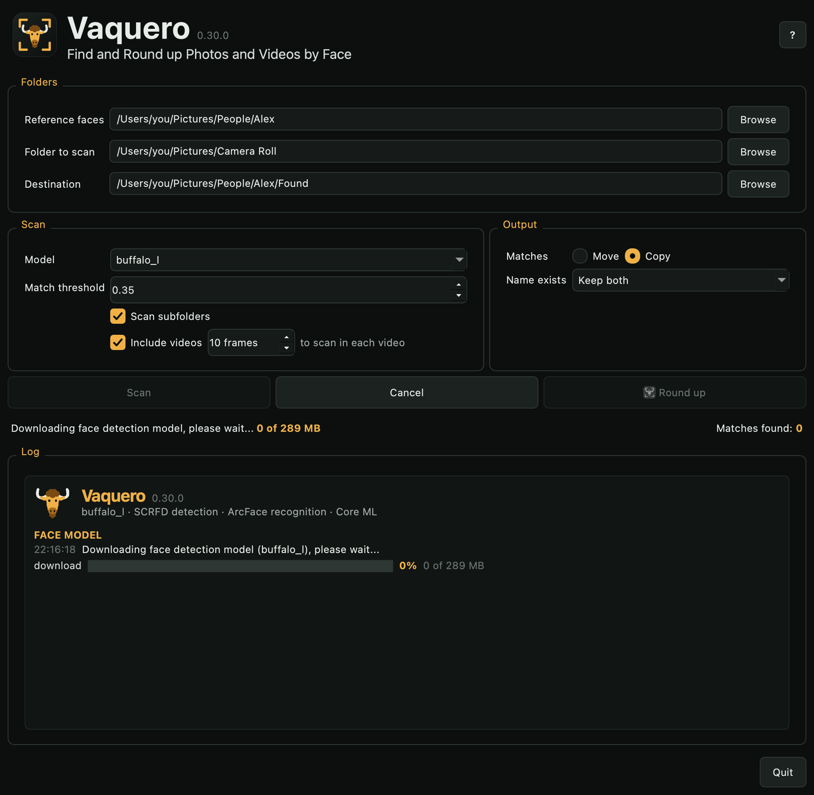

## Requirements

- A Mac with Apple Silicon (M1 or later)
- macOS 14 or later
- About 500 MB free: the app and the face model it downloads on first launch

## Install

1. Download `Vaquero-<version>-arm64.dmg` from the [latest release](https://github.com/BitWise-0x/Vaquero/releases/latest). Every version is on [Releases](https://github.com/BitWise-0x/Vaquero/releases).
2. Open it and drag **Vaquero** onto **Applications**.
3. Open Vaquero from Applications. The first launch downloads the face model (about 290 MB); scanning waits until it finishes.

Vaquero is signed with a Developer ID and notarized by Apple.

## Permissions

macOS asks once for each kind of place Vaquero opens. Click **Allow**.

| Vaquero | Needs |
|---|---|
| Downloads the face model, checks for updates | Nothing |
| Keeps its settings, logs and model | Nothing |
| Reads photos on an external drive or network share, or in Desktop, Documents or Downloads | A one-time **Allow** for that place |
| Copies or moves the matches | The same **Allow** for the destination |
| Reads photos anywhere else in your home folder, such as Pictures | Nothing |
| Notifies you when a job finishes in the background | A one-time **Allow** for notifications; optional |
| Opens at login, when turned on in **Settings** | An OK in **System Settings > General > Login Items**, when macOS asks for one |

Vaquero checks access to the chosen folders at launch and before each scan. If a place was denied, it shows a window with an **Open Settings** button and the steps to turn access back on. **Settings > Access** shows each chosen folder's state and whether Vaquero has Full Disk Access, which covers every place at once.

## First launch

Opened from the disk image, the Downloads folder, or a temporary copy macOS makes of an app opened straight from Downloads, Vaquero offers to move itself into the Applications folder (or `~/Applications` for an account that cannot write to `/Applications`) and reopen from there. The copy in Applications keeps its updates, login item and privacy permissions.

Only one copy of Vaquero runs at a time; opening it again brings up a note instead of a second copy.

## Updates

**Vaquero > Check for Updates…** downloads the latest release and restarts the app. Vaquero also checks when it opens and asks only when an update exists; turn that off in **Vaquero > Settings…**.

Before it replaces itself, Vaquero checks the downloaded app: it must carry Vaquero's own Developer ID signature, pass Gatekeeper, and be the version announced. Anything else is discarded. The old app is put back if the new one cannot be moved into place, and the next launch says why; the details are in `~/Library/Logs/Vaquero/vaquero-update.log`. The downloaded disk image is deleted once the app is copied out of it, a partial download of an older version when a newer one starts, and an update folder left beside the app on the next launch.

Vaquero updates itself only from a folder it can write to. Run from the disk image, from a temporary copy macOS makes for an app opened straight from Downloads, or from an Applications folder the account cannot change, it says so and links to the download page instead. Drag Vaquero into the Applications folder and open it from there.

## Uninstall

Drag **Vaquero** from Applications to the Trash. Its data, safe to delete:

- `~/Library/Application Support/Vaquero`: the face model and the move journal
- `~/Library/Logs/Vaquero`: logs and scan reports
- `~/Library/Preferences/com.bitwise.Vaquero.plist`: settings
- `~/Library/Caches/com.bitwise0x.vaquero` and `~/Library/HTTPStorages/com.bitwise0x.vaquero`: download caches
