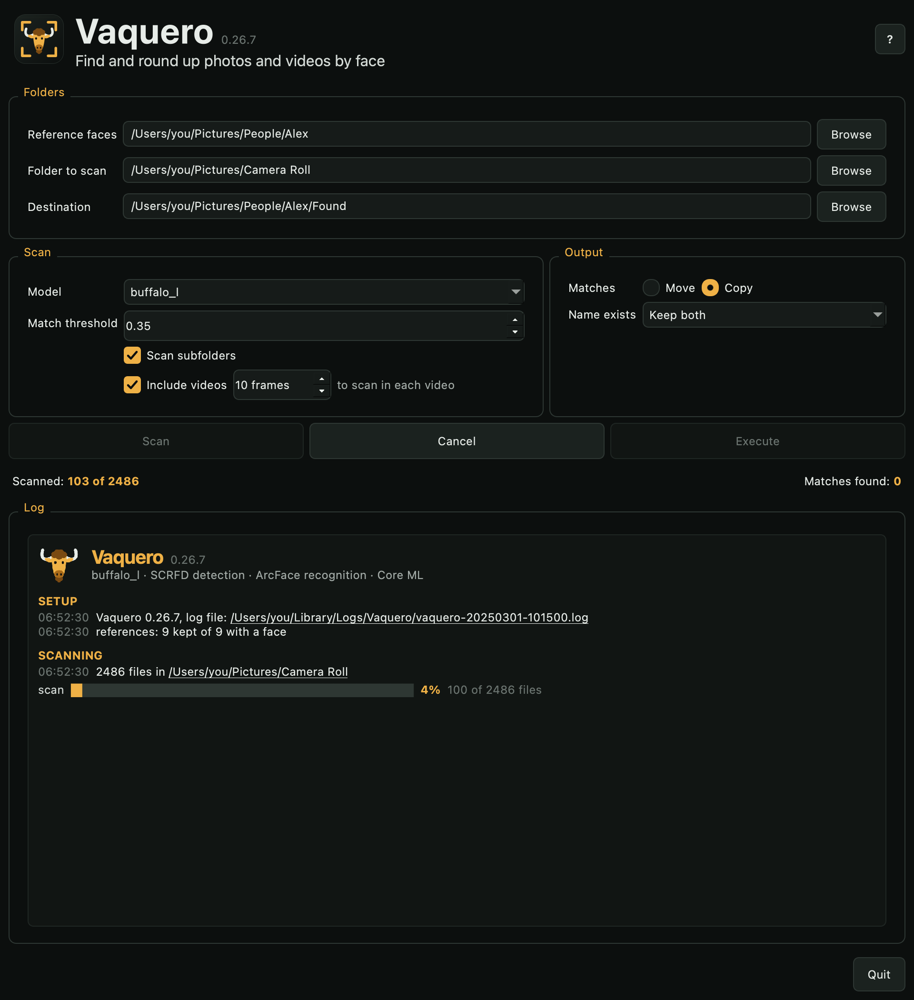
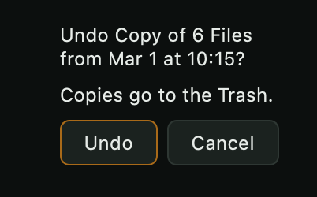
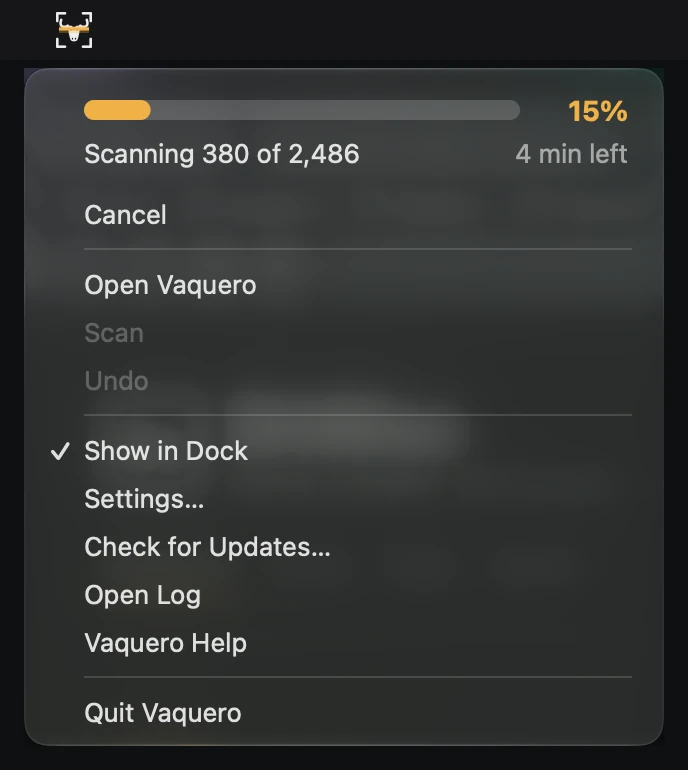
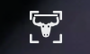
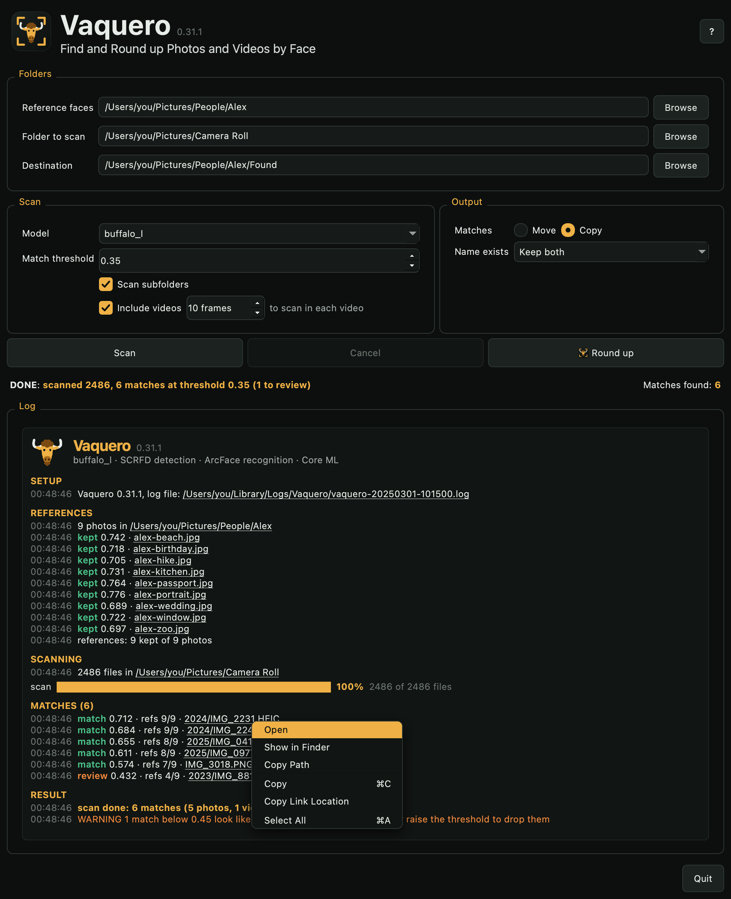

## A scan, start to finish

1. **Reference faces**: pick a folder with three to five photos of the person. See [Reference photos](reference-photos.md).
2. **Folder to scan**: pick where to look. Turn on **Scan subfolders** to look inside its folders too.
3. **Destination**: pick where the matches go. It is created if missing and never scanned.
4. Click **Scan**. Nothing moves yet.
5. Check the matches in the log. Click any file name to open it.
6. Choose **Copy** or **Move**, then click **Execute**.
7. Changed your mind? **Edit > Undo** puts the files back.

## Options

| Option | Default | Description |
|---|---|---|
| Reference faces | | Folder of photos of the person to find |
| Folder to scan | | Folder searched for that person |
| Destination | | Where matches go; created if missing |
| Move / Copy | Move | What **Execute** does with the matches |
| Name exists | Keep both | A name already in the destination: keep both, the new file numbered (`IMG_1 2.png`), or overwrite. Overwrite replaces only files that were there before the run; two matches with the same name are both kept. A file with the same name, size and modification time is skipped under either setting |
| Model | `buffalo_l` | Installed model pack |
| Scan subfolders | off | Also scan subfolders; hidden folders and the destination are skipped, and matches land flat in the destination |
| Include videos | on | Also scan videos |
| Frames | `10` | Frames sampled per video, spread evenly through it; more catch a person who appears briefly, and take longer |
| Match threshold | `0.35` | Minimum score to count as a match |

Settings persist between launches.

## File types

| Kind | Extensions |
|---|---|
| Photos | `.jpg`, `.jpeg`, `.heic`, `.heif`, `.png`, `.webp`, `.tif`, `.tiff`, `.bmp` |
| Videos | `.mov`, `.mp4`, `.m4v`, `.avi`, `.mkv` |

Other files are left alone. Hidden files and folders are skipped.

## Scores and the threshold

A file's score is how closely its best-matching face resembles the person, from -1 to 1. Photos of the same person usually score 0.5 to 0.8; different people rarely pass 0.25. The default threshold is 0.35.

Matches from 0.35 to 0.45 are where hard shots (small, blurred, side-on or heavily filtered faces) and lookalikes overlap. They are logged as `review` in orange, clearer matches as `match` in green. The done line counts the review matches.

Each match also shows `refs N/M`: how many of the M reference photos its face matches on its own. A real match usually matches most of them (`5/5`); a lookalike resembles the average face but few single photos (`0/5`, `1/5`).

Changing the threshold after a scan updates the matches without scanning again. Raise it to drop doubtful matches; lower it to catch hard shots, and check the scan report around the cutoff.

## Progress and cancelling

- The log draws a progress bar for the model download, the scan and the copy or move. The status line above the log shows the counts in amber while running, then **DONE** or **CANCELLED** with a summary.
- Before a scan or a copy or move, the folders are checked: a disconnected drive, a missing folder, missing permissions or a share that does not answer is reported in the status line, and nothing starts.
- While a large folder is listed, the status line counts the files found.
- While a scan, copy, move or download runs, the Mac does not go to sleep on its own.
- **Cancel** stops a scan, copy or move after the current file. A cancelled scan keeps the results it reached, and its matches can still be copied or moved. A cancelled copy or move leaves every file either fully done and journaled or untouched.
- A copy, or a move to another drive, writes each file under a hidden name, flushes it to disk and checks its size before it takes the real name. A full or unplugged drive never leaves a partial file or damages the file it would replace, and a move removes the original only after its copy is complete.
- When the destination fills up, turns read-only or disappears, the copy or move stops and says why. Files already done stay done and journaled. A file already in the destination with the same name, size and modification time is skipped, so running the copy or move again picks up where it stopped.
- While it runs, the status line and the menu bar menu show the time left once the pace is clear.
- **Cancel** and **Quit** ask before stopping a scan, copy, move or download. Quitting during a run cancels it and waits up to 30 seconds for the current file.
- A job that finishes while Vaquero is in the background bounces its Dock icon, badges it with the number of matches, and shows a notification. Turn notifications off in **Settings**.

## Undo

**Edit > Undo** (⌘Z) reverses the last copy or move, and is also in the menu bar menu. It asks first:

- Moved files go back to where they were.
- Copies go to the Trash.
- A file an overwrite replaced comes back out of the Trash. On a network share without a Trash, an overwrite replaces the file outright and it cannot come back.
- A file changed since, a copy whose original is gone, or a file already back in its old place is left alone and noted in the log.

Undo again for the copy or move before that. Copies and moves made before Undo existed are in the journal but cannot be undone from the menu. See [Files](files.md#move-journal).

## Menu bar and Dock

Vaquero shows in the Dock, in the menu bar, or both; choose in **Settings**. One of them is always on.

- With the menu bar icon, closing the window keeps Vaquero running there, with any scan, copy or move still going. Click the Dock icon or **Open Vaquero** in the menu bar menu to bring the window back.
- The icon holds still while Vaquero is idle, in the menu bar's own color, and its amber scan line sweeps while a scan, copy, move or download runs.

  

- Its menu opens on the running job: an amber progress bar with the percentage, and under it what is running with its count (`Scanning 1,225 of 2,486`) and the time left (`2 min left`), all moving while the menu stays open. Below come **Cancel**, **Open Vaquero**, **Scan**, **Undo**, **Show in Dock**, **Settings…**, **Check for Updates…**, **Open Log**, **Vaquero Help** and **Quit Vaquero**. Idle, the first line is a short summary of the last result, such as `6 matches in 2,486 files`; clicking it opens the window.
- Menu bar only: Vaquero has no Dock icon and no menu bar of its own; everything is in the menu bar menu.

## Menus and shortcuts

| Menu | Items |
|---|---|
| Vaquero | About Vaquero, Check for Updates…, Settings… (⌘,), Quit Vaquero (⌘Q) |
| File | Scan (⌘R), Execute (⌘E), Cancel (⌘.), Open Last Scan Report, Show Logs Folder, Close Window (⌘W) |
| Edit | Undo (⌘Z), Cut, Copy, Paste, Select All |
| Window | Minimize (⌘M), Zoom, Vaquero |
| Help | Vaquero Help, Open Log, Show Logs Folder, Vaquero Website, Report an Issue… |

## Settings

| Setting | Default | Description |
|---|---|---|
| Show Vaquero in the Dock | on | The Dock icon and the app switcher |
| Show Vaquero in the menu bar | on | The menu bar icon and its menu |
| Open Vaquero at login | off | Needs the installed app; macOS may ask for approval in **System Settings > General > Login Items** |
| Notify me when a scan, copy or move finishes in the background | on | A notification from the menu bar icon |
| Check for updates when Vaquero opens | on | See [Install](install.md#updates) |
| Keep the newest scan logs and reports | `50` | Older ones are removed when Vaquero opens |

**Access** lists each chosen folder as macOS sees it: OK, needs your permission, drive not connected, not found or no permission, and whether Vaquero has Full Disk Access, with buttons to the matching privacy settings. **Files** shows where the logs, the face model and the undo journal live. **Check Face Model** compares the model files with their pinned checksums and downloads a damaged model again; **Reset Settings…** forgets the folders, options and window size.

## The log

The log opens with the version and the engine in use, then splits into sections: **Setup** (the run's settings), **References** (each reference photo kept, with how closely it matches the others, or dropped), **Scanning**, **Matches**, **Result** (matches split into photos and videos), then **Move** or **Copy** with one progress bar. Matches and kept reference photos are green, review matches and warnings orange, errors red. Every file and folder name is a link: click it to open it, Option-click to show it in the Finder, or right-click for **Open**, **Show in Finder** and **Copy Path**. Hovering shows the full path. A file no longer there is reported in the status line, with the nearest folder that still is in the log.

Each **Scan** clears the log view and starts a new log file; the copy or move that follows writes to the same file. See [Files](files.md).
